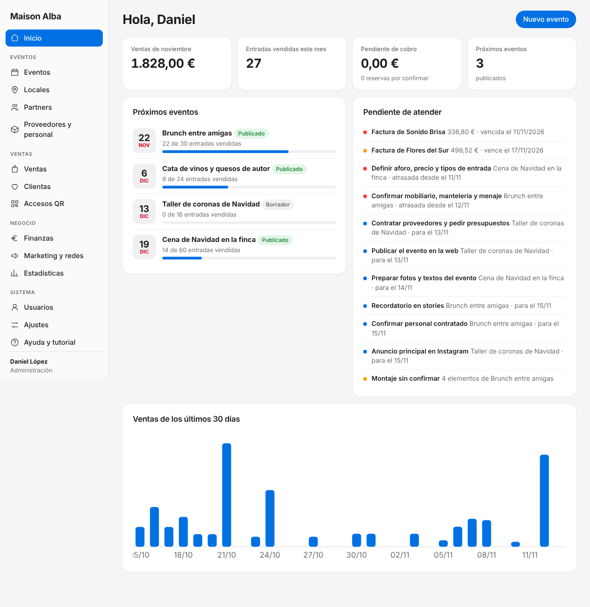

# Plataforma de venta y gestión de eventos

Aplicación web para organizar, promocionar y vender eventos: web pública con reserva y entradas QR, y panel de gestión con eventos, ventas, control de acceso, partners, locales, proveedores, finanzas, marketing y estadísticas.

PHP 8 y MySQL, sin dependencias ni proceso de compilación. Pensada para un alojamiento compartido como IONOS.

- **[Manual de uso con capturas](docs/manual.md)**
- [Instalación rápida](LEEME.md)

## Instalación

1. Crea una base de datos MySQL en el alojamiento.
2. Sube el contenido de este repositorio a la carpeta del dominio, incluidos los ficheros `.htaccess`.
3. Abre la dirección en el navegador y sigue el instalador.

El detalle está en el [manual](docs/manual.md#2-instalación-en-ionos).

## Estructura

| Carpeta | Contenido |
| --- | --- |
| `index.php` | Punto de entrada único |
| `app/` | Código: núcleo, lógica de ventas, panel (`admin/`), web pública (`site/`), tutoriales (`tours.php`) |
| `assets/` | Estilos y JavaScript |
| `config/` | Configuración generada por el instalador (no se sube al repositorio) |
| `storage/` | Documentos privados y registro de errores |
| `uploads/` | Fotos de los eventos |
| `docs/` | Manual y capturas |

## Pendiente de validar con servicios reales

- Pago con tarjeta mediante Stripe.
- Lectura de datos desde Instagram.
- Entrega de correos desde el alojamiento.

Librerías incluidas: qrcode-generator (MIT) y jsQR (Apache 2.0).
